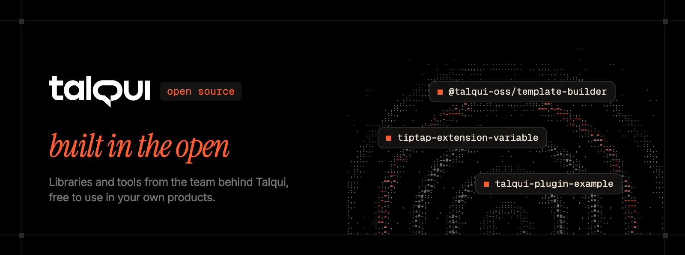

Open source from [Talqui](https://talqui.chat), the customer service platform that brings WhatsApp, Instagram, Mercado Livre and other channels into one inbox. These are the libraries and tools we build along the way and share for anyone to use.

## Featured

### [template-builder](https://github.com/talqui-oss/template-builder)

Preview, validate and create WhatsApp message templates. One JSON object, every provider.

- Checks a template against Meta's review rules before you submit it.
- Renders the preview exactly as WhatsApp shows it, in React or Vue, plus an embeddable editor.
- Builds the creation request for Meta, Twilio and Talqui.

[Website](https://template-builder.dev) · [npm](https://www.npmjs.com/package/@talqui-oss/template-builder) · [Playground](https://template-builder.dev/playground) · [Free templates](https://template-builder.dev/whatsapp-template)

## Projects

| Project | What it does |
| --- | --- |
| [template-builder](https://github.com/talqui-oss/template-builder) | Preview, validate and create WhatsApp message templates |
| [tiptap-extension-variable](https://github.com/talqui-oss/tiptap-extension-variable) | Variable nodes for the Tiptap editor |
| [talqui-plugin-example](https://github.com/talqui-oss/talqui-plugin-example) | Starter kit for plugins that connect your systems to Talqui |
| [talqui-package-changelog](https://github.com/talqui-oss/talqui-package-changelog) | Conventional Commits preset for changelogs and version bumps |
| [talqui-countries-languages](https://github.com/talqui-oss/talqui-countries-languages) | Country and language data |
| [talqui-docs-factory](https://github.com/talqui-oss/talqui-docs-factory) | Developer docs builder: guides in Markdown, references in API Blueprint |

## Maintained copies

Libraries Talqui depends on, kept here so our builds stay stable. All credit goes to their original authors, listed in each repository.

[v-hotkey](https://github.com/talqui-oss/v-hotkey) · [vue-clickaway](https://github.com/talqui-oss/vue-clickaway) · [vue-infinite-loading](https://github.com/talqui-oss/vue-infinite-loading) · [vue-swipe-actions](https://github.com/talqui-oss/vue-swipe-actions) · [vue-virtual-scroller](https://github.com/talqui-oss/vue-virtual-scroller) · [mic-recorder-to-mp3](https://github.com/talqui-oss/mic-recorder-to-mp3)

## Contributing

Issues and pull requests are welcome in each repository. For Talqui itself, see [talqui.chat](https://talqui.chat) and the [API docs](https://docs.talqui.chat).
